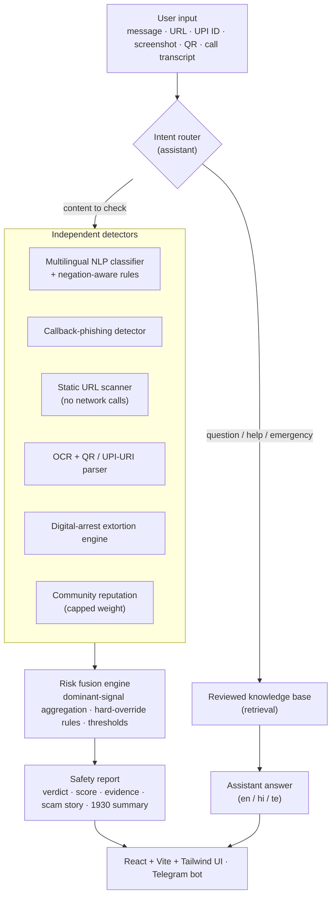

<div align="center">

# 🛡️ UPI Rakshak AI
### यूपीआई रक्षक · యూపీఐ రక్షక్

**Your digital payment safety shield: paste a suspicious message, link, screenshot or QR code, and get a clear verdict, the evidence behind it, and what to do next, in English, Hindi and Telugu.**

[](https://upi-rakshak-ai.onrender.com)
[](https://t.me/upi_rakshak_bot)
[](https://upi-rakshak-ai.onrender.com/try)


**Theme: Cybersecurity, Fintech & Digital Trust**

[Try it](#-try-it-in-60-seconds) · [How it works](#-how-it-works) · [Results](#-measured-results-and-how-to-read-them) · [Run it](#-quickstart) · [Limitations](#-honest-limitations) · [Docs](#-documentation)

</div>

---

## 🎯 The problem

UPI fraud works because it hits people at a weak moment: a fake "account will be blocked" SMS, a "₹49,999 debited, call this number" alert, a "digital arrest" video call, or a collect request that says you must enter your PIN to *receive* money. Most people have no quick way to ask, **"Is this real?"**, and almost no tools do it in Telugu or Hindi.

## 💡 The idea

UPI Rakshak AI does not simply ask a chatbot whether a message is a scam. It runs the content through **independent detectors**, fuses their **evidence** into a risk score, and shows *why*: the exact phrases, link features and patterns that triggered the verdict, plus step-by-step guidance (including the 1930 helpline). A language model is **never** the judge of a verdict.

| | |
|---|---|
| 🔍 **Evidence, not vibes** | Every verdict lists the signals behind it and which detector found them |
| 🌐 **Built for India** | English, Hindi and Telugu across UI, explanations, voice input and assistant (including Hinglish and Romanised Telugu) |
| 🔒 **Private by design** | Submitted links and QR targets are never opened; stored text is masked; users can delete their data |
| 📏 **Honest metrics** | Our evaluation report publishes the failed checks too |

---

## ✨ Features

| Area | What you get |
|---|---|
| **Threat Analyzer** | Check an **SMS/message**, **URL**, **UPI ID**, or **screenshot/QR**. Verdict (SAFE / SUSPICIOUS / HIGH RISK), 0–100 risk indicator, highlighted evidence, "why this score" breakdown, "how this scam works", and a "what to do now" checklist |
| **Rakshak Assistant** | Chat guidance for questions such as *"How do I report to 1930?"*, *"I shared my OTP, what now?"*, *"What is digital arrest?"*. It tells questions apart from messages to scan, and never gives a scam verdict for a plain question |
| **Digital Arrest Checker** | Paste a call transcript or voice-note transcript to detect police/CBI/customs impersonation and "stay on video call" coercion |
| **Insights** | Public, aggregate-only dashboard: totals, categories, languages, channels, 7-day trend. Live data and simulated demo data are clearly separated |
| **Admin Console** | Login-protected: system telemetry, moderation inbox, community entity registry, forensic audit log, and an exportable **1930 incident summary** built from masked data |
| **Telegram bot** | Forward or paste a message to get the same checks in chat |
| **Judge Bench (`/try`)** | Scan-to-test QR codes, one-click adversarial scenarios, and a printable technical handout |
| **Accessibility** | Elder mode, read-aloud, voice input (where the browser supports it), light/dark themes, responsive layout, installable PWA |

### 🧪 Try it in 60 seconds

Open the [live demo](https://upi-rakshak-ai.onrender.com), pick a sample chip or paste one of these **fictional** messages:

```text
Your UPI account will be blocked. Click here to verify immediately and enter your OTP.
```
→ expected: **HIGH RISK** (urgency threat, verification link, OTP request)

```text
Alert: ₹49,999 debited from your account. If not done by you, call +91-XXXXXXXXXX immediately.
```
→ expected: **callback-phishing pattern** flagged (call-this-number instruction with no account or reference details)

```text
₹499 debited from A/c XX1234 at ABC Store. Ref 123456. If not you, call the number on your card.
```
→ expected: **not flagged as high risk** (genuine-style alert with account suffix and reference)

Then switch the language to **తెలుగు** or **हिन्दी** and run the **Digital Arrest** samples.

---

## 🏛️ How it works



**Design principles**

1. **Detectors decide, the assistant explains.** No language model produces a scam verdict.
2. **Nothing is opened.** URLs and QR payloads are analysed statically; a test fails if any network call is attempted during URL analysis.
3. **"Safe" means "no strong scam signals found",** never a guarantee. Messages that ask you to act (call, click, pay, share) get a "verify through your bank's official app" nudge.
4. **Precision matters as much as recall.** Genuine bank alerts, OTP messages with "do not share" warnings, and merchant receipts are used as hard negatives so real alerts are not flagged.

<details>
<summary><b>🔍 The 16 categories detected</b></summary>

1. Fake bank KYC phishing
2. Electricity disconnection scam
3. Fake UPI refund / cashback
4. UPI collect-request PIN fraud
5. Lottery / advance-fee prize (KBC-style)
6. Fake customer-care helpline
7. Remote-access takeover (AnyDesk / TeamViewer / QuickSupport)
8. OTP / UPI PIN theft
9. Fake government schemes / subsidies
10. Part-time task and crypto/investment scams
11. Predatory loan-app blackmail
12. Courier narcotics / digital arrest
13. OLX / marketplace fake-QR scam
14. Accidental-transfer reversal scam
15. Fake debit alert with callback number (callback phishing)
16. Legitimate notifications (genuine bank alerts and safety advisories)

</details>

---

## 📊 Measured results (and how to read them)

Metrics are generated by `backend.app.scripts.evaluate_models` and written to [`docs/EVALUATION_REPORT.md`](docs/EVALUATION_REPORT.md), which is the source of truth if numbers ever differ.

| Check | Target | Gold v1 (306 msgs) | Gold v2 (243 msgs) | Status |
|:---|:---:|:---:|:---:|:---:|
| Scam recall (full fusion) | ≥ 95% | **98.98%** (194/196) | **97.83%** (135/138) | ✅ Passed |
| False-positive rate on legitimate messages | ≤ 3% | **0.00%** (0/110) | **0.95%** (1/105) | ✅ Passed |
| 15-class NLP macro-F1 | ≥ 0.85 | **0.8810** | **0.8233** | ✅ v1 · ❌ v2 |
| Calibration error (ECE) | < 0.10 | **0.0601** | **0.1089** | ✅ v1 · ❌ v2 |
| URL scanner phishing recall | ≥ 80% | **82.00%** (real OpenPhish hold-out) | **98.60%** (synthetic adversarial set) | ✅ Passed |
| URL scanner benign FPR | ≤ 3% | **1.60%** (Tranco-based benign set) | **1.12%** (domain-disjoint benign) | ✅ Passed |

**Please read these numbers carefully:**

- ❌ **We publish what failed.** On the more natural Gold v2 set, macro-F1 and calibration did not meet their targets. We report that instead of changing the target.
- Both gold sets were available while we built and tuned the system, so treat them as **development benchmarks, not independent proof**. A fully blind evaluation protocol is provided ([`docs/GOLD_V3.md`](docs/GOLD_V3.md), `make evaluate-blind`) and is the number that should be trusted once real, outside-the-team messages are collected.
- A large share of training data is **synthetic** (generated templates plus public datasets), so real-world accuracy will differ.
- The 98.60% adversarial URL figure comes from a generated set and is easier than real phishing; the real-feed hold-out figure (82%) is the more realistic one.
- Small test sets mean wide confidence intervals; see the report for bootstrap intervals.

### ⚡ Performance

| Measure | Result |
|:---|:---|
| Median text inference (single thread, CPU only) | **~32 ms** on an AMD Ryzen AI 5 340 laptop |
| With SQLite audit logging | **~100 ms** |
| Load test (Locust, 650 requests) | p50 **32.22 ms**, p99 **70.88 ms**, **0 errors** |

The core detection engine runs **without internet access or external API keys**. The optional AI-written explanations and the Telegram bot need a network connection. Full method and hardware in [`docs/LOAD_TEST.md`](docs/LOAD_TEST.md).

---

## 🔒 Privacy and safety by design

- **Never opens links or QR targets.** Analysis is static.
- **Masks sensitive data** (phone numbers, card/account numbers, OTP-like digits) before anything is stored; an "analyse without saving" path is available.
- **Telegram privacy:** sender IDs are salted and hashed; a `/delete_data` command removes a user's records.
- **Community reputation database** resists abuse: minimum distinct reporters, per-reporter rate limits, time decay, a cap on its weight in the final score, and an appeals path for wrongly flagged entities.
- **Admin access is enforced on the backend** (JWT, role check, login rate limiting, audit log). Public pages show aggregates only.
- **Credential hygiene is tested**, and a packaging test checks that submission zips contain no secrets, databases or virtual environments.
- **The assistant is grounded:** answers come from a human-reviewed knowledge base ([`docs/KB_REVIEW.md`](docs/KB_REVIEW.md)); phone numbers and links not in that base are stripped; it declines requests to *create* scams.
- Threat model: [`docs/SECURITY.md`](docs/SECURITY.md).

> ⚖️ **Not legal advice.** Statutory references (for example CrPC 41 / BNSS 35 in the digital-arrest guidance) are informational. Verify with official sources.

---

## 🚀 Quickstart

**Prerequisites:** Python 3.11+, Node.js 20+ (Docker optional).

<details open>
<summary><b>Windows (PowerShell)</b></summary>

```powershell
# 1. Backend setup
python -m venv .venv
.\.venv\Scripts\Activate.ps1
pip install -r backend/requirements.txt

# 2. Start the API (port 8000)
.\.venv\Scripts\uvicorn.exe backend.app.main:app --host 127.0.0.1 --port 8000

# 3. In a second terminal: start the frontend (port 5173)
cd frontend
npm install
npm run dev
```
</details>

<details>
<summary><b>Linux / macOS</b></summary>

```bash
python3 -m venv .venv && source .venv/bin/activate
pip install -r backend/requirements.txt
uvicorn backend.app.main:app --host 127.0.0.1 --port 8000

# second terminal
cd frontend && npm install && npm run dev
```
</details>

<details>
<summary><b>Docker</b></summary>

```bash
docker compose up --build
```
</details>

<details>
<summary><b>Deploy on Render (single web service)</b></summary>

1. Connect your GitHub repository to [Render](https://render.com).
2. **Build command:** `bash build.sh` (builds the React app and installs Python dependencies)
3. **Start command:** `uvicorn backend.app.main:app --host 0.0.0.0 --port $PORT`
4. **Environment variables:** `PYTHON_VERSION=3.11.9`, `NODE_VERSION=20.18.0`, and `ADMIN_PASSWORD` (set your own; never commit it).

Details: [`docs/DEPLOY.md`](docs/DEPLOY.md).
</details>

**URLs:** web app `http://localhost:5173` · API docs `http://localhost:8000/docs`

**Admin sign-in:** set `ADMIN_PASSWORD` in `.env` (see `.env.example`). If you leave it unset, a random password is generated on first start. Never share or screenshot it.

**Optional settings** (all via `.env`, none required for the core engine): `TELEGRAM_BOT_TOKEN` for the bot ([`docs/TELEGRAM_SETUP.md`](docs/TELEGRAM_SETUP.md)); assistant backend/API key for AI-written answers (the offline template mode works without one).

---

## 🧪 Testing

**234 automated tests** cover detectors, API and auth, assistant intent routing, groundedness and prompt-injection defence, mutation/obfuscation robustness, privacy masking, packaging hygiene and end-to-end UI flows.

```bash
python -m pytest backend/tests -v
```

Highlights:

| Area | What is checked |
|---|---|
| **Detection** | Callback-phishing, URL typosquats and shorteners, QR/UPI URI parsing, digital arrest, 16-category taxonomy |
| **Robustness** | Leetspeak, homoglyphs, spaced-out "O T P", prompt-injection text inside scam messages |
| **Assistant** | Intent routing, no verdicts for plain questions, PII redaction, groundedness checks, fallback behaviour |
| **Honesty gates** | Evaluation report statuses must match their numbers; banned absolute claims in docs/UI; demo docs must agree with measured metrics |
| **Security & privacy** | No hardcoded credentials, masking, role-based admin access, packaging contains no secrets |
| **UI** | Theme contrast (WCAG AA), responsive layout without horizontal overflow, end-to-end demo flow |

---

## ⚠️ Honest limitations

We would rather you hear these from us:
- **Two quality checks fail on the natural Gold v2 set** (15-class macro-F1 and calibration error). Confidence scores are risk indicators, not calibrated probabilities.
- **Largely synthetic training data** and small gold sets; real-world performance will differ until blind testing is done.
- **Telugu and Hindi quality needs native-speaker review** ([`docs/QA_LANGUAGE.md`](docs/QA_LANGUAGE.md)); OCR on poor-quality screenshots can fail.
- **No live call interception.** Android does not allow normal apps to record calls; the digital-arrest checker works on pasted transcripts.
- **Telegram only.** There is no WhatsApp bot (users can paste messages copied from any app).
- **The community database can be gamed** despite safeguards; it is a prototype.
- **This is not an official government or bank tool.** For real incidents call **1930** or report at [cybercrime.gov.in](https://cybercrime.gov.in), and contact your bank.
- **User-study results are pending.** The study harness is built ([`docs/USER_STUDY_REPORT.md`](docs/USER_STUDY_REPORT.md)); we do not claim outcomes we have not measured.

---

## 🗺️ Roadmap

- [ ] Blind **Gold v3** evaluation on real, consented, outside-the-team messages
- [ ] Verified native-speaker review of Telugu and Hindi explanations
- [ ] Voice-note / recorded-call analysis (on-device speech-to-text on user-provided recordings)
- [ ] Android prototype with SMS/notification listener (sideloaded, privacy-first, on-device where possible)
- [ ] WhatsApp channel (requires Meta Business API approval)
- [ ] Browser extension and bank / UPI-app SDK integration
- [ ] Retraining pipeline from reviewed user feedback

---

## 📚 Documentation

| Topic | Link |
|---|---|
| Evaluation report (source of truth for metrics) | [`docs/EVALUATION_REPORT.md`](docs/EVALUATION_REPORT.md) |
| Blind evaluation protocol | [`docs/GOLD_V3.md`](docs/GOLD_V3.md) |
| Knowledge-base review checklist | [`docs/KB_REVIEW.md`](docs/KB_REVIEW.md) |
| Load test | [`docs/LOAD_TEST.md`](docs/LOAD_TEST.md) |
| Security and threat model | [`docs/SECURITY.md`](docs/SECURITY.md) |
| Data sources and licences | [`docs/DATA_SOURCES.md`](docs/DATA_SOURCES.md) |
| Language quality audit | [`docs/QA_LANGUAGE.md`](docs/QA_LANGUAGE.md) |
| User study | [`docs/USER_STUDY_REPORT.md`](docs/USER_STUDY_REPORT.md) |
| Deployment guide | [`docs/DEPLOY.md`](docs/DEPLOY.md) |
| Telegram setup | [`docs/TELEGRAM_SETUP.md`](docs/TELEGRAM_SETUP.md) |
| Demo checklist · video script · pitch outline | [`docs/DEMO_CHECKLIST.md`](docs/DEMO_CHECKLIST.md) · [`docs/DEMO_VIDEO.md`](docs/DEMO_VIDEO.md) · [`docs/PITCH_OUTLINE.md`](docs/PITCH_OUTLINE.md) |
| Judge Q&A | [`docs/JUDGE_QA.md`](docs/JUDGE_QA.md) |
| Architecture decisions | [`DECISIONS.md`](DECISIONS.md) |

---

## 🧰 Tech stack

**Backend:** Python 3.11, FastAPI, SQLite · **ML/NLP:** scikit-learn (TF-IDF n-grams + calibrated linear models), rule engine, TF-IDF retrieval · **Vision:** OpenCV (QR), RapidOCR / Tesseract · **Frontend:** React, Vite, Tailwind CSS, Recharts · **Bots:** Telegram Bot API · **Testing:** pytest, Playwright, Locust · **Deploy:** Docker, Render

---

## 🤖 How this was built

- **AI tools used for development:**  claude,gemini,chatgpt
- **What the team did:** [IDEA AND SCOPE · SCAM CATEGORIES · DATA COLLECTION · REVIEWING AND CORRECTING AI OUTPUT · EVALUATION · TESTING · DEMO]
- **How we checked the work:** automated tests, programmatic evaluation reports, honesty-gate tests, manual review of Telugu/Hindi text, and a planned blind evaluation.

## 👥 Team

NEURO SHIELD · Repository: https://github.com/himesh-45/UPI_RAKSHAK-AI


<div align="center">

**If you receive a suspicious message: don't click, don't share your OTP or PIN, and call 1930.**

UPI Rakshak AI is a prototype built for a hackathon. It is an automated risk-check tool, not an official service, and can make mistakes.

</div>
