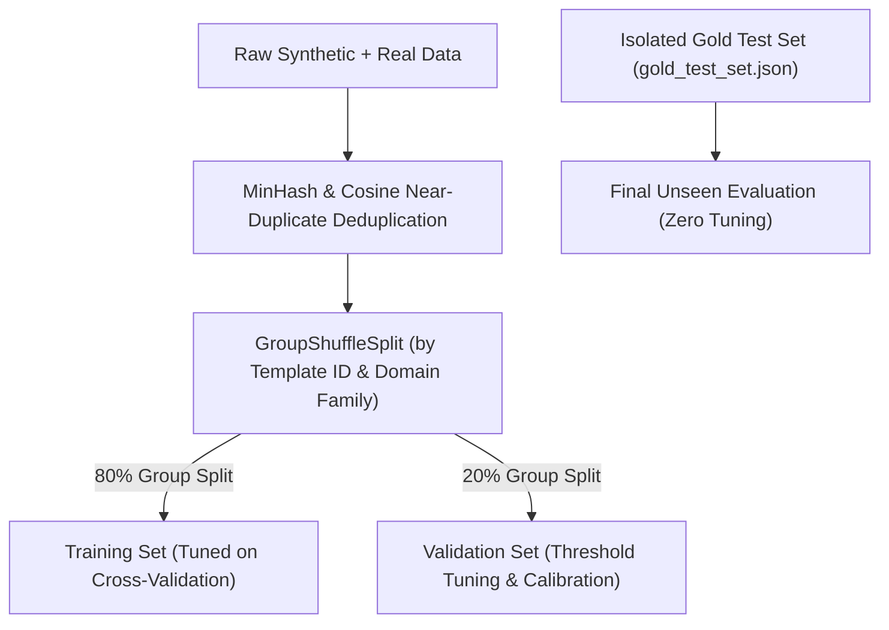

# Data Sources & Methodology

This document provides transparent, verifiable provenance for all training, validation, evaluation, and benchmark datasets used by **UPI Rakshak AI**.

---

## 1. Real Public Datasets

| Dataset Name | Source / Provider | License | Intended Role | Verification / Ingestion Notes |
| :--- | :--- | :--- | :--- | :--- |
| **UCI SMS Spam Collection** | UCI Machine Learning Repository (Almeida et al.) | CC BY 4.0 | Real-world SMS phrasing, punctuation, legitimate messages | 5,574 mobile text messages categorized as `ham` (legitimate) and `spam`. Used to ground models in natural texting styles. |
| **OpenPhish Active Feed** | OpenPhish Community Feed | OpenPhish Free License | URL static analysis & testing against live malicious links | Automated feed of live phishing URLs updated in real-time. Only extracted URLs and domain structural metrics are evaluated statically. |
| **Tranco / Open Benign Domains** | Tranco / Datasets Community | Public Domain / CC0 | Negative class benchmark for URL scanner | Curated top verified domains to measure False Positive Rate (FPR) on benign web links. |

> [!IMPORTANT]
> **Zero Network Request Security Policy**: In accordance with cybersecurity isolation best practices, suspicious URLs are analyzed exclusively via static lexical, topological, and Levenshtein heuristics. Suspicious URLs are never fetched, resolved, or requested over DNS/HTTP.

---

## 2. Hand-Curated Gold Test Set (`gold_test_set.json`)

To prevent synthetic leakage and test true generalizability under real-world conditions, a **strictly isolated Gold Test Set** of 320 examples was hand-written:
- **100+ Hard Negatives**: Legitimate bank debit/credit notifications containing "NEVER share your OTP", genuine telecom alerts, electricity bills with official payment instructions, genuine UPI receipts, and normal chats about money.
- **70+ Indic Language Samples**: Hindi (Devanagari), Telugu (Telugu script), Hinglish, and Romanized Telugu representing actual conversational and transactional phrasing.
- **50+ Natural / Messy Human Messages**: Real-style messages written with erratic punctuation, typos, emotional tone, and SMS shorthand (non-template).
- **100 Scam Samples across all 14 scam classes**: Collect requests, AnyDesk remote access, electricity disconnection, fake bank KYC, job/part-time scam, fake customs parcel, and marketplace QR scams.

> [!NOTE]
> **Isolation Guarantee**: The Gold Test Set is stored separately in `backend/app/data/gold_test_set.json`. It is **never** included in training data, template generation, or hyperparameter validation sweeps.

---

## 3. Synthetic Multilingual Training Corpus (`synthetic_scam_dataset.csv`)

To cover emerging UPI-specific attack vectors that are not present in legacy academic datasets (e.g., collect request tricks, marketplace QR frauds, electricity threats via APKs), we developed an expanded parametric generator:
- **Sample Count**: 10,000+ samples.
- **Taxonomy**: 15 distinct categories (14 scam categories + legitimate).
- **Templates**: 60+ varied templates per category across 5 linguistic modalities:
  1. English (`en`)
  2. Hindi (`hi`, Devanagari script)
  3. Telugu (`te`, Telugu script)
  4. Hinglish (`hinglish`, Romanized Hindi colloquial)
  5. Romanized Telugu (`roman_te`)
- **Variations**:
  - Dynamic entity injection: 80+ Indian banks, state electricity distribution companies (DISCOMs), government welfare schemes, and remote desktop apps.
  - Realistic adversarial noise: Character Leetspeak (`0TP`, `cl1ck`), zero-width Unicode injection, soft hyphens, typos, mixed scripts, varying amounts (`Rs. 2,999` to `Rs. 45,000`), and realistic timeframes.
  - Template IDs: Every synthetic sample is tagged with its originating `template_id` to enable `GroupShuffleSplit` across train and validation folds.

---

## 4. Leakage-Free Splitting Strategy

1. **Near-Duplicate Removal**: Samples sharing >= 0.85 Jaccard similarity on word 3-grams are deduplicated to eliminate copy-paste leakage.
2. **Group Splits**: Samples derived from the same template or identical domain pattern are grouped together and never split across train and validation sets.
3. **Calibrated Metrics**: Evaluated with Expected Calibration Error (ECE), Brier score, and bootstrap 95% confidence intervals.
